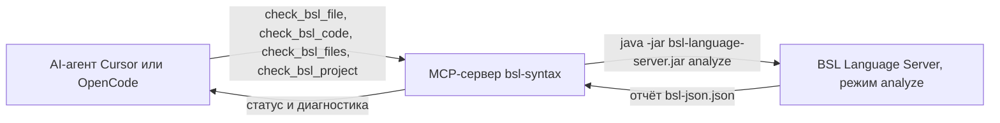

# Проверка синтаксиса 1С для Cursor и OpenCode

Локальный MCP-сервер `bsl-syntax` позволяет агенту в Cursor или OpenCode проверять модули 1С до и после правок. Сервер сам не разбирает язык. Он безопасно запускает [BSL Language Server](https://github.com/1c-syntax/bsl-language-server) и возвращает его диагностику: файл, строку, столбец, серьёзность, код правила и текст сообщения.

Облачные ключи не нужны. Исходники не отправляются во внешние сервисы и не изменяются.

## Какую задачу это решает

Агент может написать процедуру с пропущенной скобкой, точкой с запятой или незакрытой строкой и уверенно закончить задачу. Этот сервер даёт ему тот же анализатор, которым пользуются расширения 1С в редакторах: агент получает отчёт и может исправить код до ответа пользователю.

Проверяются:

- один существующий файл `.bsl` или `.os`;
- несколько указанных файлов;
- все такие файлы в выбранном каталоге исходников;
- текст, который ещё не записан в проект.

Двоичные `.cf`, `.cfe`, `.epf` и `.erf` напрямую не проверяются. Их нужно заранее выгрузить в файлы исходников.

## Как устроена проверка



Адаптер копирует проверяемые модули во временный каталог, запускает анализатор отдельным процессом и удаляет временные файлы. Так проверка не обходит каталоги вроде `.git`, не уходит по символической ссылке за пределы проекта и не записывает отчёт в исходники.

У результата четыре статуса:

| Статус | Значение |
| --- | --- |
| `passed` | Анализатор проверил указанный объём и не нашёл синтаксических ошибок. |
| `failed` | Есть синтаксическая ошибка или другая диагностика, которая по выбранному порогу мешает успеху. |
| `limited` | Проверенный текст не содержит синтаксических ошибок, но это не проверка модуля в составе конфигурации. Так завершается успешный `check_bsl_code`. |
| `not_performed` | Анализатор не установлен, не запустился, превысил таймаут или не получил пригодный файл. Это не успешная проверка. |

По умолчанию проверку не проходят диагностика разбора `ParseError` и пропущенная точка с запятой `SemicolonPresence`. Остальные правила BSL Language Server возвращаются отдельно и сами по себе статус `passed` не меняют. Порог задаётся `fail_on` или переменной `BSL_MCP_FAIL_ON`: `syntax` (по умолчанию), `error`, `warning`, `any`.

Синтаксическая корректность не гарантирует правильность бизнес-логики, текста запросов, наличие объектов конфигурации, права и успешный запуск в платформе 1С.

## Чем этот проект отличается от BSL Language Server

BSL Language Server — анализатор языка. Он разбирает модуль, считает диагностики и умеет работать как LSP-сервер. У него также есть экспериментальный режим MCP. На момент релиза 1.0.7 опубликованная документация и ветка разработки описывают этот режим по-разному, инструменты работают только с уже зарегистрированной рабочей папкой, а отдельной передачи несохранённого текста без записи в проект нет.

Этот репозиторий — тонкий адаптер для Cursor и OpenCode:

- стабильный запуск команды `analyze`, а не экспериментальный MCP-режим анализатора;
- инструменты `check_bsl_file`, `check_bsl_code`, `check_bsl_files`, `check_bsl_project`;
- проверка переданного текста во временном файле;
- ограничение путей разрешённым каталогом, таймаут и остановка дерева процессов;
- разделение синтаксических ошибок и остальных диагностик.

Парсер и тексты диагностик принадлежат BSL Language Server. Если анализатор не запустился, адаптер не подменяет результат собственными эвристиками.

## Ограничения, подтверждённые на версии 1.0.7

- Проверенная сборка: `bsl-language-server-1.0.7-exec.jar`. Другой релиз может изменить сообщения и коды.
- Нужна Java 17 или новее. Запуск проверен на Java 21.
- Анализируются `.bsl` и `.os`. Файл копируется отдельно от XML метаданных, поэтому диагностики, которым нужна конфигурация, могут быть неполными.
- Пустой файл анализатор считает допустимым.
- Файл из одной строки `КонецПроцедуры` в версии 1.0.7 не получает `ParseError`. Это ограничение анализатора, а не успешная проверка платформой.
- Каждый вызов поднимает новую Java-машину. Небольшой модуль обычно проверяется за несколько секунд.
- По умолчанию не загружается синтакс-помощник установленной платформы 1С (`v8platform.enabled` выключен). Это можно включить своим файлом конфигурации.
- `check_bsl_code` при чистом синтаксисе возвращает `limited`, а не `passed`.

## Используемые проекты и благодарности

Анализ выполняет **BSL Language Server** сообщества 1c-syntax.

- Репозиторий: https://github.com/1c-syntax/bsl-language-server
- Документация: https://1c-syntax.github.io/bsl-language-server/
- Используемый релиз: [v1.0.7](https://github.com/1c-syntax/bsl-language-server/releases/tag/v1.0.7)
- Лицензия: LGPL-3.0-or-later, текст — [COPYING.md](https://github.com/1c-syntax/bsl-language-server/blob/v1.0.7/COPYING.md)
- Авторское уведомление из исходников релиза: Copyright (c) 2018-2026 Alexey Sosnoviy, Nikita Fedkin and contributors

BSL Language Server разработан не автором этого репозитория. Jar-файл в git не входит: его скачивает пользователь с официального релиза. Полный перечень лицензий — в [THIRD-PARTY-NOTICES.md](THIRD-PARTY-NOTICES.md).

Собственный код адаптера распространяется по MIT, см. [LICENSE](LICENSE).

## Установка на Windows

Подробная копия с теми же командами: [docs/windows.md](docs/windows.md).

### Git, Java и Python

```powershell
git --version
java -version
python --version
```

Ожидается версия Git, Java 17+ (лучше 21) и Python 3.11+. Если `java` или `python` не находятся, установите Temurin 21 JDK с https://adoptium.net/temurin/releases/?version=21 и Python с https://www.python.org/downloads/windows/ с флажком добавления в `PATH`. Для поиска пакета Java в winget используйте `winget search Temurin` и ставьте тот идентификатор, который покажет поиск.

### Анализатор

```powershell
New-Item -ItemType Directory -Force -Path "$env:USERPROFILE\.bsl-mcp" | Out-Null
$jar = "$env:USERPROFILE\.bsl-mcp\bsl-language-server-1.0.7-exec.jar"
Invoke-WebRequest -Uri "https://github.com/1c-syntax/bsl-language-server/releases/download/v1.0.7/bsl-language-server-1.0.7-exec.jar" -OutFile $jar
(Get-FileHash -Algorithm SHA256 $jar).Hash
java -jar $jar version
```

SHA256 официального файла: `9F62765EDD344D66456DA24C906EAF623A03C56E90E5AAFEE466200100909F64`. Команда `version` печатает `version: 1.0.7`.

Тот же файл умеет загрузить скрипт репозитория после установки пакета:

```powershell
python scripts\download_bsl_language_server.py "$env:USERPROFILE\.bsl-mcp\bsl-language-server-1.0.7-exec.jar"
```

### Репозиторий и окружение

```powershell
git clone https://github.com/IliasNizamutdinov/1C-Language-Server-MCP-for-Cursor-and-OpenCode.git
Set-Location .\1C-Language-Server-MCP-for-Cursor-and-OpenCode
python -m venv .venv
.\.venv\Scripts\Activate.ps1
python -m pip install -e ".[dev]"
$env:BSL_LANGUAGE_SERVER_JAR = "$env:USERPROFILE\.bsl-mcp\bsl-language-server-1.0.7-exec.jar"
$env:BSL_MCP_ALLOWED_ROOTS = (Get-Location).Path
```

Сохранить путь к jar для следующих окон:

```powershell
[System.Environment]::SetEnvironmentVariable("BSL_LANGUAGE_SERVER_JAR", "$env:USERPROFILE\.bsl-mcp\bsl-language-server-1.0.7-exec.jar", "User")
```

Если PowerShell отказывается активировать окружение, выполните `Set-ExecutionPolicy -Scope CurrentUser RemoteSigned`.

### Первые проверки

```powershell
python -m bsl_mcp --check .\examples\bsl\valid-module.bsl
python -m bsl_mcp --check .\examples\bsl\syntax-error.bsl
echo $LASTEXITCODE
```

Первая команда завершается кодом 0 и статусом `passed`. Вторая — кодом 1 и статусом `failed`: `ParseError` на строке 2. Файл на диске не меняется.

Ручной запуск сервера MCP ничего не печатает в консоль и ждёт протокол на stdin. Остановка — Ctrl+C.

```powershell
python -m bsl_mcp
```

## Переменные среды

| Переменная | Назначение | По умолчанию |
| --- | --- | --- |
| `BSL_LANGUAGE_SERVER_JAR` | Путь к `*-exec.jar` | не задан, проверка не выполняется |
| `BSL_JAVA` | Исполняемый файл Java | `java` |
| `BSL_JAVA_OPTS` | Аргументы JVM одной строкой | `-Dfile.encoding=UTF-8 -Xmx768m` |
| `BSL_MCP_ALLOWED_ROOTS` | Разрешённые каталоги через `;` в Windows и `:` в Linux | текущий каталог процесса |
| `BSL_MCP_TIMEOUT` | Таймаут анализатора, секунды | `180` |
| `BSL_MCP_FAIL_ON` | `syntax`, `error`, `warning` или `any` | `syntax` |
| `BSL_MCP_MAX_CODE_BYTES` | Предел текста в `check_bsl_code` | `1048576` |
| `BSL_MCP_MAX_FILE_BYTES` | Предел одного файла | `2097152` |
| `BSL_MCP_MAX_FILES` | Предел файлов проекта | `2000` |
| `BSL_MCP_MAX_CONCURRENT` | Сколько процессов анализатора может идти одновременно | `2` |
| `BSL_LANGUAGE_SERVER_CONFIG` | Свой `.bsl-language-server.json` | не задан |
| `BSL_MCP_EXCLUDE_DIRS` | Дополнительные имена каталогов через запятую | пусто |

Из каталогов всегда исключаются `.git`, `.svn`, `.hg`, `node_modules`, `venv`, `.venv`, каталоги сборок и служебные каталоги IDE. Адаптер принудительно записывает в конфигурацию запуска `sendErrors: never`.

Свой файл конфигурации может отключать шумные правила. Образец: [examples/bsl-language-server.example.json](examples/bsl-language-server.example.json).

## Инструменты MCP

- `check_bsl_file` — аргумент `path`, необязательный `fail_on`.
- `check_bsl_code` — `code` и `file_name` (`Module.bsl` или `script.os` без каталога).
- `check_bsl_files` — массив `paths`. Ошибка одного пути не останавливает остальные.
- `check_bsl_project` — каталог `path`.

В ответе есть `summary`, `status`, `syntax_status`, группировка `files`, а у каждой диагностики — `line` и `column` с единицы, как в редакторе. Номера в сыром отчёте анализатора начинаются с нуля; адаптер переводит их в единицу.

## Cursor

Отдельная инструкция: [docs/cursor.md](docs/cursor.md). Образец: [examples/cursor/mcp.json](examples/cursor/mcp.json).

Файл проекта — `.cursor/mcp.json`, общий — `%USERPROFILE%\.cursor\mcp.json`. Документация Cursor: https://cursor.com/docs/mcp.

```json
{
  "mcpServers": {
    "bsl-syntax": {
      "type": "stdio",
      "command": "${userHome}\\.bsl-mcp\\venv\\Scripts\\python.exe",
      "args": ["-m", "bsl_mcp"],
      "env": {
        "BSL_LANGUAGE_SERVER_JAR": "${userHome}\\.bsl-mcp\\bsl-language-server-1.0.7-exec.jar",
        "BSL_MCP_ALLOWED_ROOTS": "${workspaceFolder}",
        "PYTHONIOENCODING": "utf-8",
        "PYTHONUTF8": "1"
      }
    }
  }
}
```

После сохранения перезагрузите окно Cursor. В настройках MCP сервер `bsl-syntax` должен показать четыре инструмента. Журнал — Output, канал MCP Logs.

Правило для агента уже лежит в [.cursor/rules/bsl-syntax-check.mdc](.cursor/rules/bsl-syntax-check.mdc). Скопируйте его в проект 1С. Оно просит проверять модуль после изменений, но не гарантирует вызов: это не хук редактора. Автоматический запуск после каждого сохранения не настраивался.

## OpenCode

Отдельная инструкция: [docs/opencode.md](docs/opencode.md). Образец: [examples/opencode/opencode.json](examples/opencode/opencode.json). Документация: https://opencode.ai/docs/mcp-servers/.

Конфигурация OpenCode — объект `mcp` и массив `command`, а не `mcpServers` из Cursor. Подстановки `${workspaceFolder}` в образце нет: для локального сервера OpenCode она в документации MCP не описана. Замените пути на свои.

```json
{
  "$schema": "https://opencode.ai/config.json",
  "mcp": {
    "bsl-syntax": {
      "type": "local",
      "command": [
        "C:\\Users\\USER\\.bsl-mcp\\venv\\Scripts\\python.exe",
        "-m",
        "bsl_mcp"
      ],
      "enabled": true,
      "timeout": 15000,
      "environment": {
        "BSL_LANGUAGE_SERVER_JAR": "C:\\Users\\USER\\.bsl-mcp\\bsl-language-server-1.0.7-exec.jar",
        "BSL_MCP_ALLOWED_ROOTS": "C:\\Users\\USER\\src\\my-1c-project",
        "PYTHONIOENCODING": "utf-8",
        "PYTHONUTF8": "1"
      }
    }
  }
}
```

Инструкция агента — [AGENTS.md](AGENTS.md) в корне проекта. Положите такой файл в проект 1С. Как и правило Cursor, он не запускает проверку сам.

## Примеры запросов

Один и тот же смысл подходит для Cursor и OpenCode. Агент вызывает MCP, MCP запускает BSL Language Server, анализатор возвращает диагностику, агент читает её и при необходимости правит код.

- «Проверь синтаксис этого модуля 1С и ничего в нём не меняй.» Агент вызывает `check_bsl_file`.
- «Проверь все изменённые файлы BSL.» Агент собирает пути и вызывает `check_bsl_files`.
- «Проверь все исходники 1С в каталоге src.» Агент вызывает `check_bsl_project`.
- «Напиши процедуру расчёта суммы, проверь синтаксис и исправь ошибки.» Агент пишет код, вызывает `check_bsl_code` или `check_bsl_file`, исправляет и повторяет вызов.
- «Исправь найденные ошибки и повтори проверку.» Повторный вызов после правки.
- «Проверь модуль после рефакторинга.» Снова `check_bsl_file`.
- «Выведи все ошибки с указанием файла, строки и столбца.» Агент показывает поля `file`, `line`, `column`, `message`.
- «Проверь код до его записи в файл.» Только `check_bsl_code`. Успех без синтаксических ошибок — статус `limited`.

## Поведение агента после изменений

Вызов по решению агента описан в правиле Cursor и в `AGENTS.md`: прочитать код, проверить, исправить синтаксис, проверить снова и честно сообщить результат. Это не автоматический хук. Если клиент не вызвал инструмент, проверка не выполнялась.

Отдельной проверенной автоматизации, которая сама запускала бы анализатор после каждого сохранения, в проекте нет.

## Устранение неполадок

Таблица с причинами и действиями: [docs/troubleshooting.md](docs/troubleshooting.md).

Кратко: сервер не стартует — проверьте `python -m bsl_mcp --version`; нет Java — `java -version` и переменная `BSL_JAVA`; нет анализатора — путь к `*-exec.jar` и команда `version`; клиент не видит инструменты — сверьте формат своего клиента и журнал; таймаут — увеличьте `BSL_MCP_TIMEOUT` и сузьте каталог; файл `.cf` — сначала выгрузите исходники.

## Разработка

Структура, тесты и обновление анализатора: [docs/development.md](docs/development.md).

```powershell
python -m pytest tests/test_paths.py tests/test_report.py tests/test_service.py
$env:BSL_LANGUAGE_SERVER_JAR = "$env:USERPROFILE\.bsl-mcp\bsl-language-server-1.0.7-exec.jar"
python -m pytest
```

Модульные тесты подменяют процесс анализатора и проверяют пути, таймаут, очистку временных файлов и отсутствие ложного успеха. Интеграционные тесты требуют Java и официальный jar. Они гоняют настоящие модули, в том числе полный вызов инструментов через STDIO. Если jar не указан, интеграционный тест завершается ошибкой, а не молчаливым пропуском.
